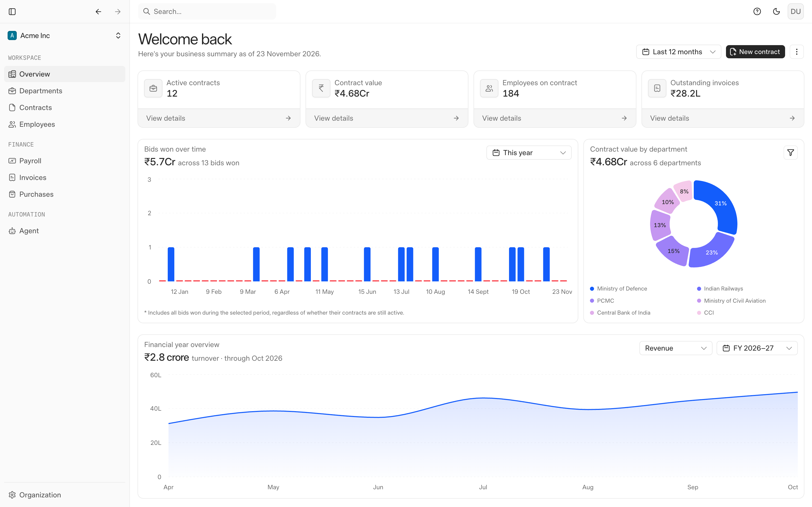

<p align="center">
  
</p>

<h1 align="center">TenderLayer</h1>

<p align="center">Manage tenders, contracts, employees, and finances in one workspace.</p>

<p align="center">
  <a href="https://github.com/arhamkhnz/tenderlayer/releases">Download</a> ·
  <a href="https://tenderlayer.com">Website</a> ·
  <a href="https://github.com/arhamkhnz/tenderlayer/issues">Report an issue</a>
</p>

<p align="center">
  
</p>

## Why TenderLayer

TenderLayer grew out of a family-run outsourcing business in India. As the business took on more contracts, employee records, payroll, invoices, and payments became harder to manage. Free and paid tools helped with parts of the work, but much of it still depended on spreadsheets and separate records.

An earlier web application was built for the business. TenderLayer takes that experience further as a desktop application, bringing related work together and keeping business data on the user’s computer.

## Current status

TenderLayer is in early alpha. Several screens still use sample data, and some forms are previews. The dashboard screenshot above shows demonstration data.

The first phase focuses on work after a tender has been awarded:

- **Departments and contracts:** contract details, locations, dates, and the departments they belong to.
- **Employees:** employee records, contract assignments, site locations, and monthly wages.
- **Finance:** payroll, payslips, invoices, purchases, GST details, and payment tracking.
- **Records:** documents, notes, deadlines, and contract history.

These features are being developed and are not all functional yet.

## Roadmap

- **Upcoming bids:** tender opportunities, eligibility checks, bid preparation, submission tracking, and outcomes.
- **Agent:** help with routine tasks and tender preparation, with human review before critical declarations or submissions.
- **Sync and collaboration:** optional cloud and local network sync, shared access, and backups.

## Download

Download a testing build from [GitHub Releases](https://github.com/arhamkhnz/tenderlayer/releases):

- **macOS:** Apple Silicon (arm64), available as DMG and ZIP.
- **Windows:** x64 installer.

The macOS builds are not notarized, and Windows installers are unsigned, so your operating system may show a security warning.

## Development

Requires Node.js `>=24.11.0` and npm `11.16.0`.

```sh
git clone https://github.com/arhamkhnz/tenderlayer.git
cd tenderlayer
npm ci
npm run dev:desktop
```

To work on the website, run `npm run dev:site`. See the [desktop guide](apps/desktop/README.md#getting-started) and [website guide](apps/site/README.md#getting-started) for more setup details and commands.

## Contributing

Bug reports, feedback, and pull requests are welcome. For larger changes, open an issue first so we can discuss the approach. Keep pull requests focused and explain what changed and how you checked it.
